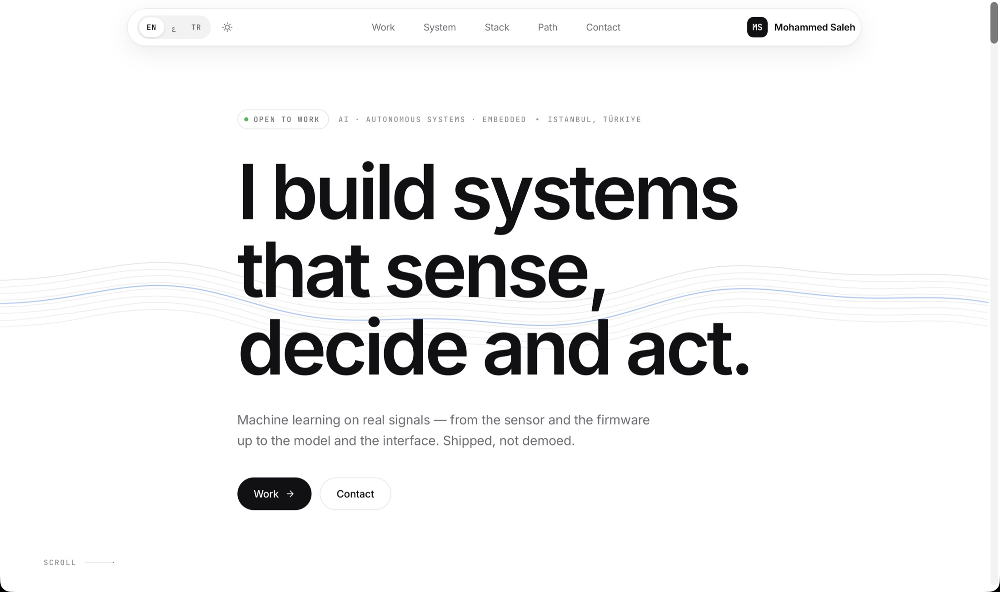
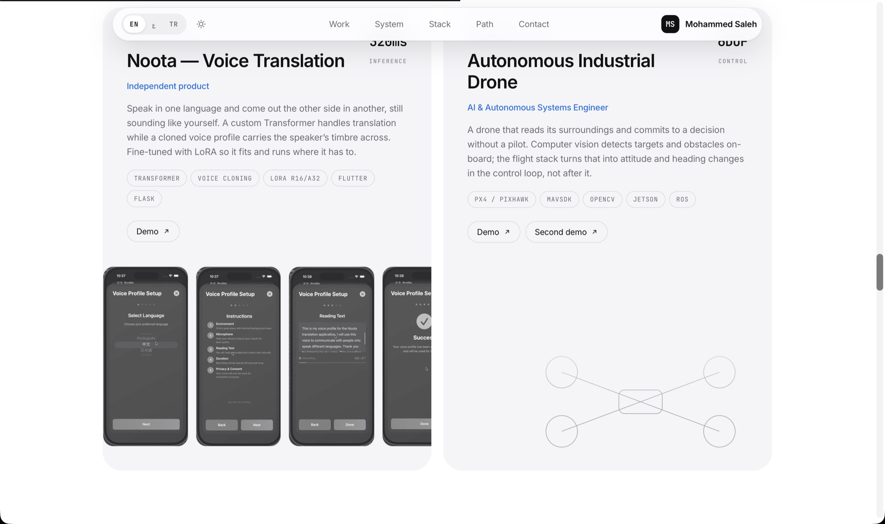
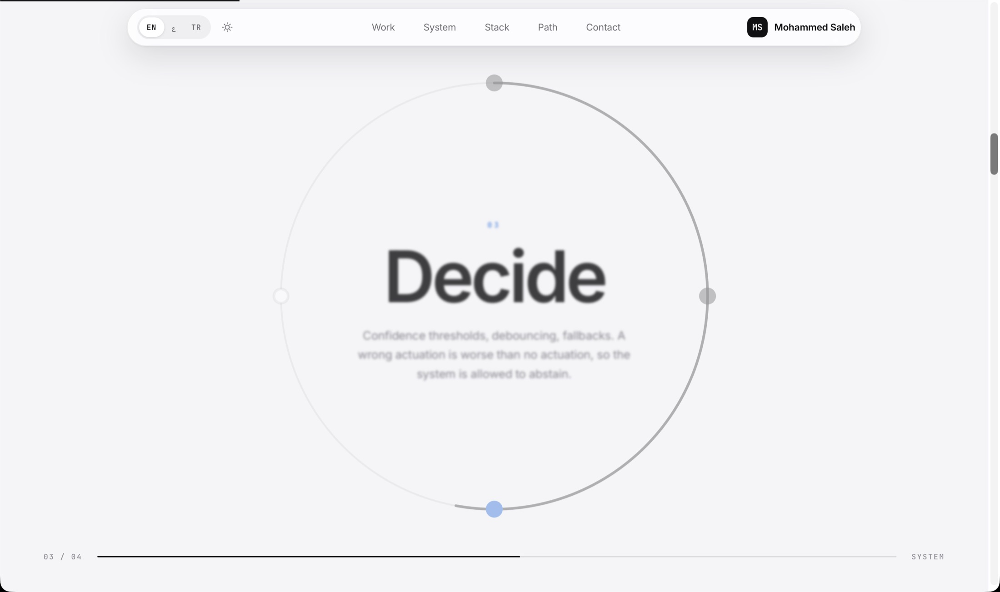
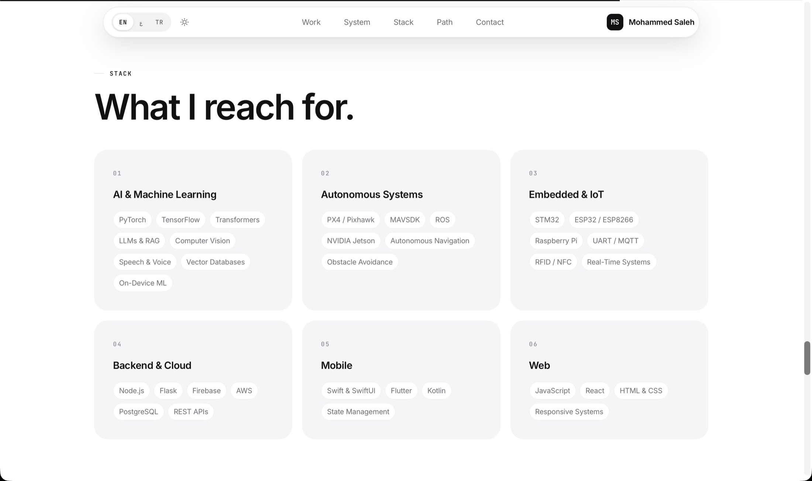
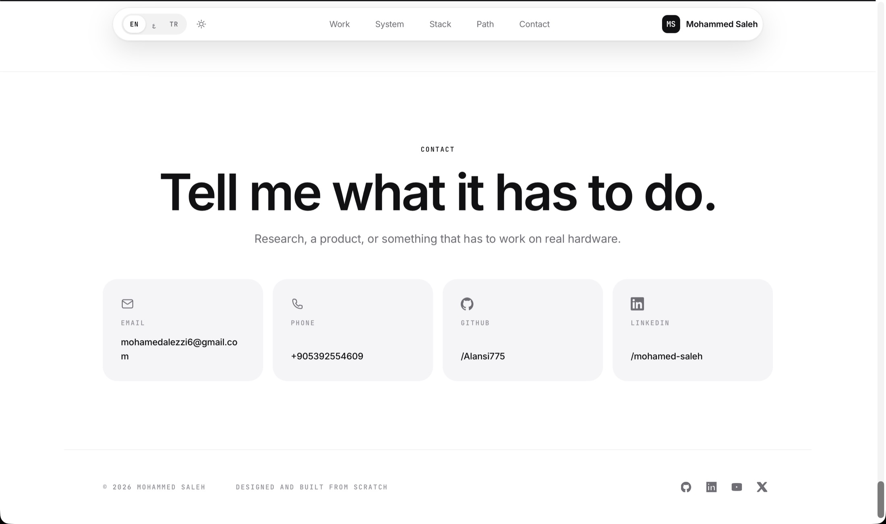

# Mohammed Saleh — Portfolio

Monochrome, trilingual (EN / AR / TR), with real RTL, a clock-aware
theme, and two pieces of motion that are derived from the work rather
than borrowed from a template.

No framework. No build step. No dependencies. Five ES modules, one
stylesheet, and an `index.html` that opens from disk.

---



<table>
<tr>
<td width="50%"></td>
<td width="50%"></td>
</tr>
<tr>
<td width="50%"></td>
<td width="50%"></td>
</tr>
</table>

---

## The two signature pieces

**The hero is a signal field.** Eight traces of noisy data — the shape
of an EMG electrode array — drift apart, then collapse onto one
coherent waveform as a decision boundary resolves across them. It is
the thing the work is about, drawn live on a canvas: sense, infer,
decide.

**The system section is scrubbed by scroll.** Every system here runs
the same four-stage loop, so the page shows that loop instead of
describing it. Scroll position drives the stage depth, the dial's arc
and which node is live. Nothing runs on a timer, so it scrubs in both
directions and holds wherever you stop.

---

## Stack

Vanilla HTML, CSS and ES modules.

```
index.html          markup + the pre-paint theme script
css/style.css       one stylesheet, token-driven
js/
  app.js            language, theme, rendering, filtering
  field.js          the hero's signal field
  scenes.js         the scroll-scrubbed system loop
  data.js           projects, metrics, skills, experience
  i18n.js           every string, in three languages
assets/             project screenshots
backend/            optional Node service for the contact form
```

The only external resources are three Google Fonts. Everything else —
the geometry, the easing, the layout engine for the split headlines —
is in this repository.

---

## Engineering notes

The parts that were not obvious.

### Arabic is a joining script

The headlines split into animated units. Splitting to the **glyph**
works in Latin and destroys Arabic: a letter's shape depends on its
neighbours and it joins them, so a box per character forces the
isolated form and severs every join.

Everything therefore splits at the **word**, which is the smallest unit
that survives in all three scripts. The same reasoning removed negative
letter-spacing from every Arabic heading — tightening pushes marks into
the neighbouring glyph.

There is a related trap on the JavaScript side. An early version cached
each headline's text on first run, to survive re-splitting. That cache
held the *English* copy, so switching language wrote English back over
the translation. The text is now read live on every pass.

### Controls do not mirror

The nav bar and the language switch are pinned to one arrangement in
every language (`direction: ltr` on the bar itself). They are controls,
not prose: mirroring them meant a reader switching to Arabic had to
find the theme toggle again, and the chip they had just pressed jumped
to the other end of the row. Arabic *labels* still shape correctly —
bidi handles each run inside its own cell.

### FLIP, and why it needs cancelling

Filtering measures where every card is, changes the set, measures where
each landed, then plays each card from its old slot to its new one.

Re-entrancy is most of the difficulty: filters get clicked faster than
the sequence runs. Every pass now cancels the previous one outright,
because an exit animation left with `fill: forwards` outlives itself
and pins `opacity: 0` onto cards that later come back — which is how
they vanish permanently.

### The browser chrome follows the page

`theme-color` is a single value for the whole document. On iOS the
status and toolbar strips are painted from it, and changing the meta's
`content` in place does not reliably trigger a repaint — so the element
is **replaced**, and every stale tag removed first, since Safari
honours the first one it finds.

The page also omits `viewport-fit=cover` deliberately. With it, the
page extends under the status bar and home indicator and becomes
responsible for painting them; without it, Safari insets the viewport
and fills those strips with the page background itself.

### Sliding pills are measured, not guessed

The language and filter pills are positioned from `offsetLeft`, not a
viewport rect. Both strips scroll sideways on a phone, and a rect would
be measured against a position that has scrolled away — the pill would
drift off the selected segment. A `ResizeObserver` re-runs the
measurement when the webfont swaps or a language brings wider labels.

### Graceful by default

`prefers-reduced-motion` collapses the system loop into a readable
stack, stops the signal field and removes every entrance animation. The
canvas also stops when it scrolls out of view or the tab is hidden —
it paints around 1 200 points a frame and has no business running
unseen.

---

## Running it

```bash
python3 -m http.server 5174
# http://localhost:5174
```

No build, no install.

## Editing content

- **Projects, metrics, skills, experience** → `js/data.js`
- **Every string, in all three languages** → `js/i18n.js`

Adding a language means adding a key to `LANGS`, a direction to `DIR`
and a block to `T`. Nothing else is language-aware.

---

## Contact

**[mohamedalezzi6@gmail.com](mailto:mohamedalezzi6@gmail.com)** ·
[LinkedIn](https://linkedin.com/in/mohamed-saleh-a2a496276) ·
[GitHub](https://github.com/Alansi775)
